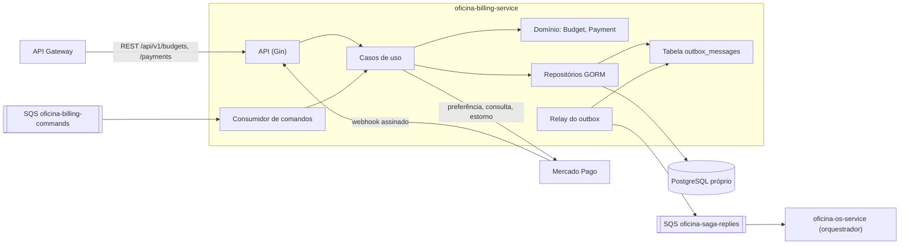

# Tech Challenge — Oficina Mecânica · Billing Service

[](https://github.com/gaabriel165/oficina-billing-service/actions/workflows/ci.yml)
[](https://sonarcloud.io/summary/new_code?id=gaabriel165_oficina-billing-service)
[](https://sonarcloud.io/summary/new_code?id=gaabriel165_oficina-billing-service)

Microsserviço de **orçamento e pagamento** da oficina mecânica. Gera o orçamento a partir do diagnóstico, registra a aprovação ou a recusa do cliente, cobra pelo **Mercado Pago** e estorna quando a saga precisa compensar.

Parte do Tech Challenge da pós-graduação em Arquitetura de Software (FIAP SOAT) — Fase 4.

## Repositórios do projeto

| Repositório | Papel |
|---|---|
| [`oficina-os-service`](https://github.com/gaabriel165/oficina-os-service) | Ordens de serviço, clientes, veículos e orquestração da saga |
| **`oficina-billing-service`** (este) | Orçamento e pagamento |
| [`oficina-execution-service`](https://github.com/gaabriel165/oficina-execution-service) | Diagnóstico, execução, catálogo e estoque |
| [`oficina-lambda-auth`](https://github.com/gaabriel165/oficina-lambda-auth) | Autenticação por CPF e API Gateway |
| [`oficina-infra-k8s`](https://github.com/gaabriel165/oficina-infra-k8s) | VPC, EKS e base compartilhada |
| [`oficina-infra-db`](https://github.com/gaabriel165/oficina-infra-db) | Banco do OS Service |

A visão do sistema inteiro, o desenho da saga e a justificativa do padrão estão no [README do OS Service](https://github.com/gaabriel165/oficina-os-service#readme).

## Stack

- Go 1.26, Gin, GORM
- PostgreSQL 16 (banco exclusivo deste serviço), migrations com golang-migrate
- Amazon SQS para comandos e respostas da saga
- Mercado Pago (Checkout Pro) como gateway de pagamento
- OpenTelemetry (traces) e `slog` em JSON (logs), enviados ao New Relic
- Terraform, Kubernetes (EKS) e GitHub Actions

## Arquitetura



O código segue Clean Architecture: `domain` → `application` → `infrastructure` → `api`. O domínio não conhece GORM, SQS nem Mercado Pago; o gateway de pagamento é uma porta (`PaymentGatewayService`) com duas implementações, a do Mercado Pago e uma falsa para execução local.

## Comunicação

**Assíncrona (saga).** O serviço consome comandos da fila `oficina-billing-commands` e responde na fila `oficina-saga-replies`.

| Comando recebido | O que faz | Resposta |
|---|---|---|
| `GenerateBudget` | Cria o orçamento com os itens do diagnóstico e avisa o cliente por e-mail | `BudgetGenerated` |
| `RequestPayment` | Cria a cobrança no Mercado Pago e envia o link ao cliente | `PaymentRequested` |
| `CancelBudget` | Compensação: cancela o orçamento | `BudgetCancelled` |
| `RefundPayment` | Compensação: estorna o pagamento confirmado | `PaymentRefunded` |

Decisões do cliente e do Mercado Pago também viram respostas: `BudgetApproved`, `BudgetRejected`, `PaymentConfirmed` e `PaymentFailed`.

As mensagens de saída são gravadas na tabela `outbox_messages` na mesma transação da mudança de estado e publicadas em seguida; o consumidor registra cada mensagem processada para ignorar repetições. Depois de 5 entregas sem sucesso a mensagem vai para a fila `oficina-billing-commands-dlq`.

Os contratos estão em [`messaging-contracts.md`](https://github.com/gaabriel165/oficina-os-service/blob/main/docs/architecture/messaging-contracts.md).

**Síncrona (REST).** Rotas sob `/api/v1`, protegidas por JWT:

| Método e rota | Quem | Descrição |
|---|---|---|
| `GET /budgets` | operador e cliente | Lista orçamentos; o cliente só vê os seus. Filtro `order_id` |
| `GET /budgets/{id}` | operador e cliente | Consulta um orçamento |
| `GET /budgets/{id}/payment` | operador e cliente | Pagamento do orçamento, com o link de checkout |
| `PATCH /budgets/{id}/approve` | operador e cliente | Aprova o orçamento |
| `PATCH /budgets/{id}/reject` | operador e cliente | Recusa o orçamento, com motivo |
| `GET /payments/{id}` | operador | Consulta um pagamento |
| `POST /payments/{id}/simulate` | operador e cliente | Simula o resultado do pagamento; só existe com `PAYMENT_GATEWAY=fake` |
| `POST /webhooks/mercadopago` | Mercado Pago | Notificação de pagamento; pública, validada pela assinatura `x-signature` |

A documentação interativa fica em `/swagger/index.html`.

## Mercado Pago

Com `PAYMENT_GATEWAY=mercadopago` o serviço:

1. Cria uma **preferência** do Checkout Pro com os itens do orçamento. A `external_reference` é o id do pagamento local e a `notification_url` aponta para o webhook deste serviço.
2. Devolve o `init_point` como link de checkout, enviado ao cliente por e-mail e exposto em `GET /budgets/{id}/payment`.
3. Recebe a notificação no webhook, valida a assinatura (HMAC-SHA256 do manifesto `id;request-id;ts` com a assinatura secreta da aplicação), consulta o pagamento na API do Mercado Pago e confirma ou reprova o pagamento local.
4. Estorna pelo endpoint de reembolso, com chave de idempotência, quando a saga envia `RefundPayment`.

Com `PAYMENT_GATEWAY=fake` (padrão local) nada sai para a internet: o link de checkout aponta para `POST /payments/{id}/simulate`.

## Como executar

```bash
cp .env.example .env
docker-compose up --build
```

Sobem a aplicação (porta `8081`), o PostgreSQL e o ElasticMQ, que emula o SQS localmente.

```bash
curl http://localhost:8081/health
curl http://localhost:8081/ready
```

Para rodar os três microsserviços juntos, use `make system/up` no repositório [`oficina-os-service`](https://github.com/gaabriel165/oficina-os-service).

## Variáveis de ambiente

| Variável | Descrição |
|---|---|
| `SERVER_PORT` | Porta HTTP |
| `APP_ENV` | Ambiente, incluído nos logs e traces |
| `DATABASE_URL` | Conexão com o PostgreSQL deste serviço |
| `JWT_SECRET` | Chave HS256 compartilhada com os outros serviços e a Lambda |
| `AWS_REGION`, `SQS_ENDPOINT` | Região e endpoint do SQS (endpoint só para o emulador local) |
| `BILLING_COMMANDS_QUEUE`, `SAGA_REPLIES_QUEUE` | Nomes das filas |
| `PAYMENT_GATEWAY` | `fake` ou `mercadopago` |
| `PUBLIC_BASE_URL` | URL pública do serviço, usada no endereço do webhook |
| `MERCADOPAGO_ACCESS_TOKEN`, `MERCADOPAGO_WEBHOOK_SECRET`, `MERCADOPAGO_BASE_URL` | Credenciais e endereço da API do Mercado Pago |
| `RESEND_API_KEY`, `EMAIL_FROM` | Envio de e-mail; sem chave o envio é ignorado |
| `OTEL_SERVICE_NAME`, `OTEL_EXPORTER_OTLP_ENDPOINT`, `OTEL_EXPORTER_OTLP_HEADERS` | Exportação de traces |

## Testes e cobertura

```bash
make test/unit
make test/integration
make test/coverage
make coverage/check
```

- **Unitários**: entidades, todos os casos de uso, rotas HTTP, consumidor de comandos, gateway do Mercado Pago (contra um servidor HTTP simulado) e validação da assinatura do webhook.
- **Integração**: repositórios, outbox e consumo de fila contra PostgreSQL e ElasticMQ reais, com testcontainers. Precisam do Docker em execução.
- **Cobertura**: medida sobre os pacotes do serviço somando testes unitários e de integração. O pipeline falha abaixo de **80%**; a medição atual é de **94,4%** ([SonarCloud](https://sonarcloud.io/summary/overall?id=gaabriel165_oficina-billing-service)).

O cenário em BDD do fluxo completo da ordem de serviço fica no [OS Service](https://github.com/gaabriel165/oficina-os-service/blob/main/internal/integration/features/saga_ordem_de_servico.feature).

## CI/CD

A branch `main` é protegida: toda mudança entra por pull request com os checks aprovados.

- **CI** (`.github/workflows/ci.yml`), em cada pull request e em `main`: build, `go vet`, testes unitários, testes de integração com cobertura, gate de 80%, análise do SonarCloud com quality gate, validação dos manifests e do Terraform e build da imagem.
- **CD** (`.github/workflows/cd.yml`), em cada push para `main`: autentica na AWS por OIDC, aplica o Terraform do serviço, publica a imagem no ECR, cria o `Secret` a partir do SSM e dos secrets do GitHub e faz o rollout no EKS. A execução manual com `destroy` remove o workload e a infraestrutura.

## Infraestrutura

Tudo o que é exclusivo deste serviço é provisionado pelo Terraform em `terraform/`:

| Recurso | Uso |
|---|---|
| RDS PostgreSQL `oficina-billing-service-db` | Banco exclusivo |
| SQS `oficina-billing-commands` e `-dlq` | Comandos da saga e fila de mensagens com falha |
| IAM role `oficina-billing-service-pod` | Assumida pelos pods (IRSA), com acesso só às filas deste fluxo |
| SSM `/oficina-billing-service/database_url` | String de conexão lida pelo deploy |

Os manifests em `k8s/` (kustomize) criam o namespace `oficina-billing`, o `ServiceAccount`, o `Deployment` com probes, o `Service` (NLB) e o `HPA`. VPC, cluster e repositório de imagens vêm do [`oficina-infra-k8s`](https://github.com/gaabriel165/oficina-infra-k8s).

## Estrutura de pastas

```
cmd/api                  ponto de entrada
configs                  leitura de variáveis de ambiente
internal/domain          entidades, portas e contratos de mensagens
internal/application     casos de uso e relay do outbox
internal/infrastructure  PostgreSQL, SQS, Mercado Pago, e-mail e observabilidade
internal/api             handlers, middlewares, consumidor e DTOs
migrations               migrations versionadas
docs                     Swagger gerado
k8s                      manifests do Kubernetes
terraform                infraestrutura do serviço
```
